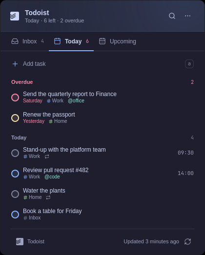

# Foamy Todoist

An Omarchy bar plugin for Todoist: the tasks left today in the bar, and a
popup with your Inbox, Today, Upcoming and (in the wide panel) each of your
projects. Add tasks with Todoist's own Quick Add syntax, complete them with
a click or Space, and open any of them in Todoist.



The bar shows the Todoist mark and, in the bar's urgent colour, the number
of tasks left today (overdue plus due today), like Foamy Zendesk's count.
Nothing left today, or **Show in the bar: Icon only**, leaves just the mark;
signed out, the mark stands alone. The tooltip says how many are left and how
many of them are overdue.

## The panel

The band at the top holds the Todoist mark, the title, the current view and
its count, a **Search** button and ⋯ (**Open in Todoist** opens the current
view in the browser; **Settings** is last). In the standard panel a row of
tabs under it picks **Inbox**, **Today** or **Upcoming**, with their counts
(Today's in red while something is overdue). The **wide** panel (560 px,
where the screen has room) has no tabs: a rail on the left lists the three
views, then **My projects** (sub-projects indented one step) with their
open tasks.

The list starts with a quiet **Add task** row (key `a`); nothing has the
cursor when the popup opens.

- **Inbox**: the Inbox project in Todoist's order, subtasks under their
  parent, sections with a header.
- **Today**: **Overdue** (oldest first), then today's tasks: those with a
  time by time, then the rest in Todoist's Today order and by priority.
- **Upcoming**: a folded **Overdue** row (→, Enter or a click opens it),
  then one group per day up to the end of this week, headed by the weekday
  and, muted, the date (**Tomorrow** Tuesday 17 November, **Wednesday** 18
  November), then **Next week** (with its dates, 23–29 Nov),
  **Later in November** (the rest of this month), then one group per month
  ("December", "January 2027": the year only when it isn't this year). The
  week starts on the day your language's locale starts it (Monday in
  Norwegian). The later groups have a hairline above them and their count on
  the right; their tasks show the weekday (and, after next week, the date)
  before the time. Today's sections show their counts on the right too. The band counts the tasks of the next seven days. A task
  added in Upcoming gets the day of the day group the cursor was last in,
  else tomorrow.
- **A project** (wide): its tasks without a section first, then each
  section.

Each row has a ring in the priority's colour (p1 red, p2 orange, p3 accent,
p4 grey), the task (Markdown links show their text), and a line with what
the view doesn't already say, in this order: the date (red when overdue;
"Yesterday", a weekday within a week, else "Mon 23 Nov" in your language;
none in Today's Today section or in Upcoming, which groups by day), the
project (in every view but that project's own), `@labels`, the person it is
assigned to when that isn't you (first name), and a repeat icon for
recurring tasks; a due time shows on the right. A row without that line is
one line tall; the text, the ring and the time are centred either way.

**Completing**: click the ring or press Space. The task stays, struck
through, with **Undo**; four seconds after the last completion every
pending one is sent to Todoist in one request (at once when the popup
closes). Undo only takes it back here, so nothing is sent. If Todoist
refuses a completion the task comes back and the line under the field says
why. When the request fails as a whole (no answer, the network), Todoist may
or may not have done it, so those tasks show dimmed and can't be completed
or moved again until the next refresh, which starts at once. A recurring
task moves to its next date, as in Todoist.

**Adding**: click the **Add task** row, press Enter or Space on it, or
press `a` anywhere: the row turns into a field in its place, with the view's
date in a chip and "Enter adds · Esc closes" under it. Enter adds the task
and keeps the field open for the next one; the task appears when Todoist has
answered (a spinner shows meanwhile). An error shows under the field and
keeps the text. When the task was sent but no answer came back (a timeout,
a lost connection), Todoist may have added it: the line says so, the text
stays, and the list refreshes at once, so you can check before pressing
Enter again. Esc clears the text, and on an empty field closes it back to
the row. An empty field also closes when it loses the keys (a click on a
tab, a task, a button, ↓ into the list); one with text stays open. Text
you've typed is never thrown away by moving around: it stays when you
switch views, Tab doesn't leave a field with text in it (Tab from an empty
field goes to the next panel), and when the popup closes the draft is kept
for this session and comes back, with the caret at its end, the next time
the popup opens. Adding the task or clearing it with Esc ends the draft. A
suggestion that would make the text longer than 500 characters isn't put
in (the line under the field says so). At most 500 characters. The text
goes to Todoist's Quick Add (see below).

**Suggestions**: typing `#` at the start of a word lists your projects (the
Inbox too), `@` your labels (your personal ones and the shared labels on
open tasks). The list drops from the field and narrows as you type: names
that start with what you typed first, then names that contain it, at most
six. ↓/↑ pick one, Enter or Tab (or a click) puts it in, as `#Name` or
`@name` with spaces written `\ ` the way Quick Add reads them, followed by
a space. After a `#project`, `/` lists that project's sections (`/Name`),
and in a project you share `+` lists the people in it, you included, with
their email beside the name (`+Full\ Name`). A project counts as shared
when Todoist says so or when two or more people are active in it (team and
workspace projects come marked unshared). Without a `#project` before
them, `/` and `+` suggest nothing; `+` neither in a project only you are in.
The Quick Add docs say how to write project names with spaces (`\ `), not
labels, sections or people; the plugin escapes them the same way, which is
not verified against Todoist yet. Esc closes only the list. With the list
closed, Enter adds the task as before. Search never shows suggestions.

**Search** (the button, or `/`): the add row turns into a search field
that searches every open task by text, project name and labels, shown
grouped by project. Esc clears the text, then leaves search. Leaving
search (Esc, another view, the button again) puts back an add draft you
had started before it, the caret at its end; without one, the Add row
returns.

The footer has a **Todoist** button on the left that opens the current
view in Todoist (with the open command, see Settings); when that fails, the
footer says so until a launch works. On the right it shows when the tasks
were last updated and **Refresh**. When a
refresh fails the tasks stay as they were, the footer keeps the time they
are from, and the line under the field says what failed. When Todoist asks
to slow down, no refresh, add or change is sent until the time it gave has
passed; adds and changes asked for meanwhile fail at once and say so. At
most 20 requests wait in line; more are refused with "Too many changes are
waiting". A very large account (over 20 000 open tasks, 2 000 projects or
5 000 sections) shows only part of it, and a muted line under the field
says so (an empty view then says that too, not "Nothing planned").

## Quick Add syntax

The text you add goes to Todoist's own Quick Add, which reads it the way the
Todoist apps do: `#Project`, `/Section`, `@label`, `p1` to `p4`, dates in
plain words in your account's language ("tomorrow 9am", "every Monday"),
`{deadline}`, `!reminder` (`!30m`), `+assignee` in a shared project, and
` // description` at the end. The view's date (today in Today, the chip's
day in Upcoming) applies only when the text gives no date, and the
project's view moves the task there only when the text names no project: a
`#` at the start or after a space, followed by a non-space
(`Buy milk #Inbox` stays in the Inbox; `C#` and `email#1` don't count).

## Keyboard

| Key | Where | Does |
|---|---|---|
| Alt+1, Alt+2, Alt+3 | anywhere, also while typing | Inbox, Today, Upcoming |
| 1, 2, 3 | the list | the same |
| ↓ | nothing selected | the **Add task** row |
| Enter, Space | the **Add task** row | open the add field in its place |
| a | anywhere (signed in) | open the add field |
| Enter | the field | add the task, keep the field open (in search: go to the results) |
| ↓ / ↑ | the field | the first row / the tabs (the rail when wide) |
| Esc | the field | clear the text; when empty close the field (and leave search) |
| ↓ ↑, Enter or Tab, Esc | the suggestion list | pick, put it in, close the list |
| ↑ ↓ j k | the list | move; ↑ on the first row goes to the **Add task** row, ↑ from there to the tabs |
| Space | a row | complete (again: undo) |
| Enter | a row | open the task in Todoist |
| t | a row | move to tomorrow (not for recurring tasks) |
| / | the list | search |
| ← → | the tabs | pick a view (Enter or Space shows it) |
| ↑ ↓, Enter | the rail (wide) | pick a view or project; ← from the list goes to the rail |
| r, s | the list | refresh, Settings |
| Esc | the list | close |
| Tab, Shift+Tab | the list, or an empty field | the next or previous panel (in a field with text: nothing) |

## Settings

Open them from the ⋯ menu, with `s`, or by right-clicking the bar icon.

- **Account**: signed out, paste your API token and press **Save token**.
  Find it in Todoist under Settings → Integrations → Developer (**Open
  Todoist settings** goes there). The token is checked with Todoist before
  it is stored. Signed in, the page shows who, and **Sign out**.
- **Panel width**: Standard or Wide.
- **Open on**: Today, Inbox, Upcoming or Last view (kept until the shell
  restarts).
- **Tasks assigned to others**: Hide (default) or Show. A task is someone
  else's when it is assigned to a person other than you (unassigned tasks are
  yours). Hidden, they stay out of Today, Upcoming and the Inbox, the bar
  number and its tooltip, and the Inbox/Today/Upcoming counts. A project
  view, search and the projects' counts in the rail always show every task.
- **Open command**: what opens Todoist links (the footer button, Enter on
  a task, **Open in Todoist**). Empty (**Browser (default)**) uses
  `xdg-open`. Otherwise, for example `omarchy-launch-or-focus-webapp
  Todoist {url}`: the command is split on spaces and run without a shell
  (quotes and pipes aren't supported), `{url}` is replaced with the link,
  and without it the link is added at the end. It must start with a command
  name or an absolute path, at most 300 characters. It runs in its own
  session, so what it opens stays when the shell restarts. Only
  `https://app.todoist.com/` links are ever opened.
- **Show in the bar**: Tasks left today or Icon only.
- **Refresh every**: 1 to 30 minutes (5 by default). The popup also
  refreshes when it opens and the data is older than 30 seconds. After a
  failure the wait doubles, up to 30 minutes, and never ends before
  Todoist's own retry time when it asks to slow down.

IPC (`omarchy-shell foamy.todoist <function>`): `toggle`, `add` (opens the
popup with the add field open and the caret in it), `refresh`,
`openTask <id>` (opens that task in Todoist with the open command, as Enter
on a task does; an id that isn't a Todoist id is refused and logged) and
`openInbox` (the Inbox, the same way).

## Other plugins

Foamy Menu adds tasks through this plugin's helper,
`bin/<arch>/foamy-todoist-helper`, so the token, the cache and the requests
to Todoist stay here. Every reply has `"contract": 1`, the version of the
replies other plugins read. The commands they use:

- `names`: the projects, sections, labels and people in the cache, for
  suggestions, and the open tasks (at most 1 000, dated ones first, each
  cut to 200 characters and 10 labels), for the launcher's task search. No network; empty lists when signed out or
  before the first sync.
- `add` with `"reply": "task"`: adds as the panel does, but replies with the
  added task and its project instead of every task.
- `notify`: a desktop notification about an add, through
  `omarchy-notification-send`, with the texts the caller translated. Its
  button runs `openTask` or `openInbox` above. The helper waits at most 2
  seconds for it.

The requests and replies are described at the top of `native/src/main.rs`.

## Privacy

- The API token lives in your keyring (Secret Service, through
  `secret-tool`, as "Foamy Todoist API token"). It is never written to a
  file, a log or the settings, and never passed on a command line.
- `$XDG_CACHE_HOME/foamy-todoist/cache.json` (else
  `~/.cache/foamy-todoist/`, owner-only) keeps the open tasks, projects,
  sections, your personal labels, the names and emails of the people you
  share projects with (for `+` suggestions), your name, email and Inbox id, and
  Todoist's sync token, so a refresh only fetches what changed. Signing out
  removes it.
- The only server contacted is `api.todoist.com`. Opening a task or view
  hands an `https://app.todoist.com/app/…` link to your browser.
- When Foamy Menu asks for a notification (`notify`), the task's text,
  project, date and labels, or the text you typed, are in the command line
  of `omarchy-notification-send` while it runs, so other programs of yours
  can see them in the process list for that moment. Nothing else the
  helper runs gets task text on its command line.

## Languages

English and Norwegian (`i18n/en.json`, `i18n/no.json`), following the
shell's language. Dates, weekdays and months use the locale, and so does the
first day of the week in Upcoming. Every text the panel shows is a catalog
key, including the helper's errors; `tests/i18n.test.cjs` checks that both
catalogs cover everything, with matching placeholders and no unused entries.

## Install

Requires Omarchy 4.5.

```sh
omarchy plugin add https://github.com/foamrider/foamy-todoist.git --enable
```

To remove it, sign out first (that removes the token from the keyring and
the cache), then run `omarchy plugin remove foamy.todoist`.

## Verifying the helper binaries

`bin/x86_64/foamy-todoist-helper` and `bin/aarch64/foamy-todoist-helper`
are compiled from the Rust source in this repository: `native/`, the shared
crate in `kit/rust/`, the dependencies locked in `Cargo.lock` and the
toolchain pinned in `rust-toolchain.toml`, with the build tool in
`kit/native/`. The build is reproducible. `native/native.pin` records the
toolchain, a hash of every build input (`source`) and the SHA-256 of each
binary. [`THIRD_PARTY_NOTICES.md`](THIRD_PARTY_NOTICES.md) lists the
third-party code linked into the binaries (crates, the Rust standard
library, musl, LLVM's libunwind) with the license texts and copyright
notices it ships; the build writes it and the verification below
regenerates and compares it.

**CI.** The [Verify native helpers](https://github.com/foamrider/foamy-todoist/actions/workflows/verify-native.yml)
workflow rebuilds both binaries on a GitHub-hosted runner for every push,
compares them byte for byte with `bin/`, and attests the rebuilt files. To
check the committed files against that attestation (GitHub CLI):

```sh
gh attestation verify bin/x86_64/foamy-todoist-helper --repo foamrider/foamy-todoist \
  --signer-workflow foamrider/foamy-todoist/.github/workflows/verify-native.yml \
  --deny-self-hosted-runners
gh attestation verify bin/aarch64/foamy-todoist-helper --repo foamrider/foamy-todoist \
  --signer-workflow foamrider/foamy-todoist/.github/workflows/verify-native.yml \
  --deny-self-hosted-runners
```

Add `--source-digest <commit>` to require a particular commit.

**Yourself.** You need `rustup`, Python 3.11 or newer and `file`. From a
checkout of this repository at the commit you want to check:

```sh
rustup toolchain install "$(awk '$1 == "toolchain" { print $2 }' native/native.pin)" \
  --profile minimal --target x86_64-unknown-linux-musl,aarch64-unknown-linux-musl
kit/native/build-native.sh . --verify
```

It builds both binaries from scratch in `~/.cache/foamy-native/` (nothing is
written to the checkout), compares them byte for byte with `bin/`, checks
that the kit files are unmodified, that `native.pin` matches the source and
that `THIRD_PARTY_NOTICES.md` equals a fresh generation, and ends with
`verify OK (<binary>, <toolchain>, both arches reproducible)`.

## License

Licensed under [MIT](LICENSE). Omarchy and Lucide notices are in
[kit/LICENSE-OMARCHY](kit/LICENSE-OMARCHY) and [kit/LICENSE-LUCIDE](kit/LICENSE-LUCIDE).
Todoist is a trademark of Doist Inc.; this plugin is not affiliated with or
endorsed by Doist.

Provided **as is**, without warranty or guaranteed support. Use at your own risk.

## Validation

```sh
mise install            # once: the linters and node that mise.toml pins
tests/validate.sh       # kit-check, omarchy-plugin-validate, linters, formatters,
                        # the helper's tests and tests/suite.sh (node, i18n, runtime)
tests/validate.sh --ci  # what GitHub's runner can do: no Quickshell or Omarchy host
kit/native/build-native.sh . --test     # fmt, clippy, cargo test
kit/native/build-native.sh .            # rebuild bin/<arch>/ and native/native.pin
kit/native/build-native.sh . --verify   # byte-identical clean rebuild
python3 ../foamy-kit/preview/render.py . --out /tmp/foamy-todoist-preview   # add --theme light
```

The helper's tests run the real binary against a Todoist stand-in on
loopback (`FOAMY_TODOIST_BASE_URL`) and a fake `secret-tool`, in temporary
HOME and XDG directories. The runtime test loads the real panel and store
offscreen with a stand-in helper. Nothing touches a real account or keyring.
The previews and tests use the sample tasks in `preview/Fixtures.js`.

Shared components are copied from foamy-kit and pinned by `foamy-kit.lock`.
Change the kit source and sync; never edit its stamped copies here.
